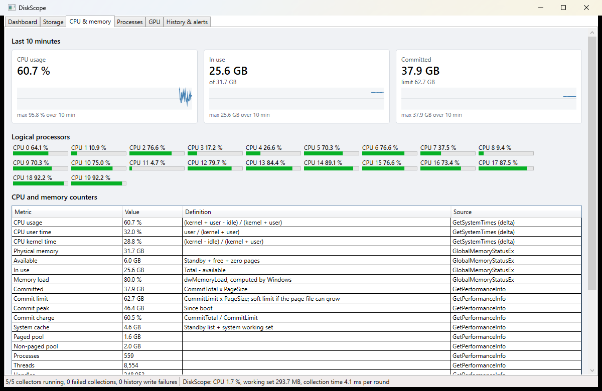
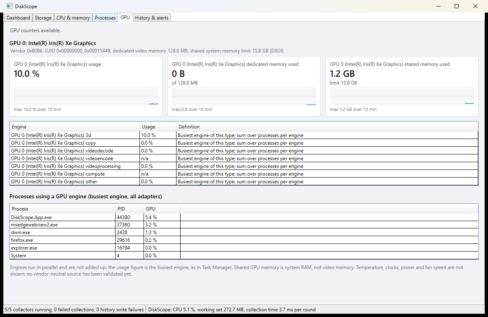

# DiskScope

A read-only Windows control center: where your disk space goes, and what your CPU, memory and GPU are doing. Native WPF on .NET 10, no external runtime dependency.

DiskScope measures; it does not "optimize" behind your back. It never deletes, moves or modifies files, never stops a process, never changes a service. When a value cannot be read, it says `n/a` instead of showing `0`.


## Features

### Storage

- Scan any folder or drive with a standard engine built on `GetFileInformationByHandleEx` (one handle per directory, sizes from directory entries). Handles access denied, long paths, junctions and symlinks (never followed, so no cycles), files deleted during the scan, cancellation.
- Results are shown while the scan runs, flagged as partial until it ends. An inaccessible folder is flagged, never shown as empty.
- Size tree sorted by size, logical or allocated size (never mixed), file counts, percentages, and the last change anywhere in each subtree (to spot abandoned folders). Expanded folders stay open while results refresh.
- Squarified treemap drawn in one element (no control per file), synchronized with the tree: click to select, double-click to zoom in, right-click to zoom out.
- Search and filters (name, extensions, size, modification date, type), largest files, size per extension.
- CSV export (RFC 4180). Copy path and open in Explorer from the context menu.
- Index sized for millions of entries: struct-of-arrays, no object or path string per file (about 260 bytes per node, measured).

### Monitoring

- **Dashboard**: CPU, memory in use, commit charge, GPU, free space per volume, active alerts, memory growth suspicions, DiskScope's own CPU. Each card opens its module and shows the average, maximum and trend over its window (least-squares change, shown only once half the window is covered).
- **CPU & memory**: global and per-logical-processor usage, user/kernel split, physical memory, commit charge and limit, cache, kernel pools, process/thread/handle counts. Every counter lists its definition and Windows source.
- **Processes**: parent/child tree (PID reuse detected with creation times), CPU % of the machine, private bytes, working set, private working set, threads, handles, I/O, start time, path. Sustained private memory growth is flagged as a suspicion to verify, not as a leak. A "By application" view groups processes by program with 5 minutes of history (CPU average and maximum, memory trend) and states what closing each application would return (private RAM and commit); Windows components and processes it cannot inspect get no estimate. DiskScope never ends a process itself.
- **GPU**: per adapter, usage per engine type (3D, copy, video decode/encode/processing, compute), dedicated and shared memory, processes using the GPU. Engines are not added together; shared memory is not presented as VRAM.
- **Disk activity**: active time, read/write throughput, latency and queue for all physical disks.
- **History & alerts**: in-memory history (1 s for 10 min, 5 s for 1 h, 1 min for 24 h), explainable alerts with evidence (CPU, available memory, commit charge, disk latency), editable thresholds, acknowledgement.
- **Hypotheses**: correlations such as "low memory coincided with heavy disk activity: paging is likely", each with its confidence, data, checks to run and limits. Never presented as a proven cause.
- **Startup & services**: read-only inventory of Run keys, startup folders, logon/boot scheduled tasks and services, with CSV export. No invented "impact score".
- **Reports**: history CSV, process CSV, JSON and self-contained HTML reports. No machine name, user name or command line in them.
- The cost of monitoring is itself measured and displayed (wall-clock and CPU time per collector, DiskScope CPU and memory).

| CPU & memory | GPU |
|---|---|
|  |  |

## Requirements

- Windows 10 or 11, x64. GPU monitoring needs WDDM 2.0 or later (Windows 10 1709+).
- To build: the .NET 10 SDK (the version pinned in `global.json`, or a later feature band).
- No administrator rights needed. Without them, some system processes show `n/a` for their details, and the NTFS fast path (not finished, see below) is unavailable.

## Build and run

```
git clone https://github.com/poirouxmartin/DiskScope.git
cd DiskScope
dotnet build DiskScope.slnx -c Release
dotnet run --project src/DiskScope.App -c Release
```

Tests:

```
dotnet test DiskScope.slnx
```

There is no installer or signed release yet.

## Measured performance

Numbers come from `src/DiskScope.Benchmarks` with the procedure in `docs/BENCHMARK-PROTOCOL.md`, recorded in `docs/benchmarks/RESULTS.md`. Highlights, from a single noisy dev laptop (so indicative only):

- Index: 1 million synthetic nodes built in about 130 ms, 259 bytes per node; search over them in 16-31 ms.
- Monitoring without UI: 0.25 % of the machine's CPU; collectors take 0.1 to 3.3 ms on average; listing about 545 processes takes 72 ms (median).

```
dotnet run -c Release --project src/DiskScope.Benchmarks -- monitor --seconds 60
dotnet run -c Release --project src/DiskScope.Benchmarks -- synthetic
dotnet run -c Release --project src/DiskScope.Benchmarks -- scan <folder>
dotnet run -c Release --project src/DiskScope.Benchmarks -- inspect <folder> [--node <path>]
```

`inspect` lists every directory that could not be read, with its error, and describes one node (sizes, counts, last change in the subtree; unknown values print `n/a`).

## Status and limits

Work in progress. Known gaps:

- NTFS fast engine: the USN record parser and tree rebuild are written and tested, but enumeration of a real volume needs an elevated console and has not been run yet; sizes still come from the standard engine (`docs/NTFS-RISKS.md`).
- History is kept in memory only and lost on exit.
- No ETW tracing yet, and nothing can be changed from the startup and services view (read-only by design for now).
- No CPU frequency, no GPU temperature, clocks, power or fans, no hardware sensors, no network monitoring yet: no reliable vendor-neutral source has been validated.
- Not compared side by side with Task Manager yet; expected differences are documented in `docs/MONITORING.md`.

Roadmap: `ROADMAP.md`.

## Documentation

- `docs/STORAGE-REPORT.md`: final report of the storage module (what works, evidence, open items).
- `docs/MONITORING-REPORT.md`: report of the CPU, memory and GPU modules (what works, evidence, open items).
- `docs/PUBLISHING.md`: open-source publication checklist and history privacy audit.
- `docs/ARCHITECTURE.md`: modules, storage index, counting rules, engine contract.
- `docs/MONITORING.md`: every metric, its formula, source and limits; history; alert rules.
- `docs/GPU-COMPATIBILITY.md`: GPU sources, definitions and tested hardware.
- `docs/NTFS-RISKS.md`: NTFS engine study and status.
- `docs/BENCHMARK-PROTOCOL.md`, `docs/benchmarks/RESULTS.md`: how performance is measured, and the results.
- `docs/spec/`: the original specification (French).

## License

MIT, see `LICENSE`.
